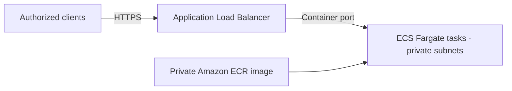

# EAAF DevOps

EAAF DevOps is the Architecture-to-Terraform module in the EAAF ecosystem. This increment defines the version 1 architecture manifest for one AWS pattern. It accepts structured YAML and returns a normalized manifest with review decisions.

## AWS ECS Fargate web service



The application is stateless and runs without public task IP addresses. The load balancer can be public or internal. The pattern uses an existing VPC and private subnets. The manifest records how tasks reach dependencies, either through NAT or the VPC endpoints required by the workload. [AWS ECS load balancing](https://docs.aws.amazon.com/AmazonECS/latest/developerguide/service-load-balancing.html) · [AWS Fargate task networking](https://docs.aws.amazon.com/AmazonECS/latest/developerguide/fargate-task-networking.html)

| Section | Inputs needed for review |
| --- | --- |
| `application` | Container port, private ECR image URI, confirmation that the application is stateless |
| `aws` | Workload region and existing VPC ID |
| `ingress` | Public or internal HTTPS entry point, domain name, ACM certificate ARN |
| `runtime` | Two or more distinct private subnet IDs and an outbound connectivity choice |

The [version 1 schema](eaaf_devops/architecture.py) rejects unexpected fields and invalid field types. The validator derives the status and lists open decisions and conflicts. The example account and resource IDs are fictional.

`ready_for_review` means the manifest contains the inputs required for this pattern. An AWS review still checks resource ownership and existence, certificate coverage, subnet placement and routes, IAM, and security groups before a Terraform plan can be approved.

## Run locally

Use Python 3.12 and run from the repository root.

```sh
python -m pip install -r requirements-dev.txt
python -m eaaf_devops examples/complete.yaml
python -m eaaf_devops --schema
python -m pytest -q
```

| Example | Expected result | Exit code |
| --- | --- | ---: |
| [Complete](examples/complete.yaml) | `ready_for_review` | 0 |
| [Incomplete](examples/incomplete.yaml) | `needs_input` with open decisions | 2 |
| [Outside the pattern](examples/outside-pattern.yaml) | `unsupported` with an explanation | 3 |

Unreadable or invalid input exits with code 1.

## Incremental delivery

1. **Architecture contract · available.** Review and validate structured manifests against the first AWS pattern.
2. **Architecture intake · next.** Turn a description into a draft manifest through the EAAF Core HTTP API, using a dedicated application identity. Keep the validator as the final check.
3. **Terraform output · planned.** Generate configuration from an approved manifest and versioned template. Run formatting and validation in CI.
4. **AWS sandbox plan · planned.** Review the plan before making a separate decision to apply.

This increment runs locally with Python and needs no AWS account.
