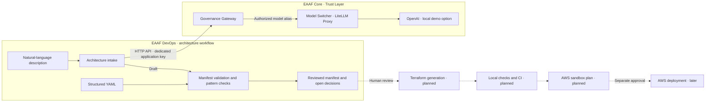
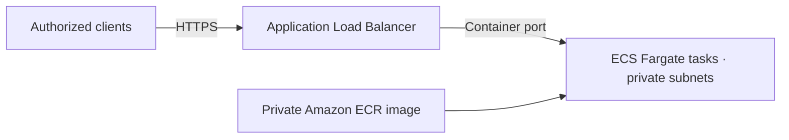

# EAAF DevOps

EAAF DevOps is the AWS-first Architecture-to-Terraform module of the Enterprise Agentic AI Framework. It lives in a separate repository and uses EAAF Core as its governance layer for model calls.

The current MVP turns a structured YAML file or a natural-language description into a reviewable architecture manifest for a stateless web service on AWS ECS Fargate. It reports missing decisions and conflicts with the supported pattern.

## Target architecture



Solid lines show the paths implemented today. Dashed lines show planned steps. EAAF Core authenticates DevOps and applies its model allowlist, quotas, simulated budget, and audit policy. DevOps owns the architecture schema, AWS pattern rules, and review status. The structured YAML path runs locally with Python and needs neither the Gateway nor an AWS account. The description path requires the local Gateway and sends the input to OpenAI through LiteLLM.

## Components and delivery roadmap

| Increment | Component | Demonstrable outcome | Status |
| --- | --- | --- | --- |
| 1 | Architecture contract | Validate YAML against the ECS Fargate pattern and report missing inputs or conflicts. | Available |
| 2 | Governed architecture intake | Draft a manifest from a description through the dedicated DevOps identity and apply the same validation as for YAML. | Available |
| 3 | Terraform generation | Generate configuration from a reviewed manifest and a versioned pattern template. Run formatting and validation locally and in CI. | Planned |
| 4 | AWS sandbox plan | Compare the plan with the reviewed manifest and record the human decision before any apply. | Planned |

Each increment has its own validation step. The first two can be exercised with fictional examples. Terraform generation will add a deterministic output to inspect, and the sandbox step will introduce AWS access for reviewing the plan. A deployment requires a separate approval.

## AWS ECS Fargate web service



The application is stateless and runs without public task IP addresses. The load balancer can be public or internal. The pattern uses an existing VPC and private subnets. The manifest records how tasks reach dependencies, either through NAT or the VPC endpoints required by the workload. [AWS ECS load balancing](https://docs.aws.amazon.com/AmazonECS/latest/developerguide/service-load-balancing.html) · [AWS Fargate task networking](https://docs.aws.amazon.com/AmazonECS/latest/developerguide/fargate-task-networking.html)

| Section | Inputs needed for review |
| --- | --- |
| `application` | Container port, private ECR image URI, confirmation that the application is stateless |
| `aws` | Workload region and existing VPC ID |
| `ingress` | Public or internal HTTPS entry point, domain name, ACM certificate ARN |
| `runtime` | Two or more distinct private subnet IDs and an outbound connectivity choice |

The [version 1 schema](eaaf_devops/architecture.py) rejects unexpected fields and invalid field types. The validator derives the status and lists open decisions and conflicts. The example account and resource IDs are fictional.

`ready_for_review` means the manifest contains the inputs required for this pattern. An AWS review still checks resource ownership and existence, certificate coverage, subnet placement and routes, IAM, and security groups before a Terraform plan can be approved.

## Run locally

Use Python 3.12 and run from the repository root.

```sh
python -m pip install -r requirements-dev.txt
python -m eaaf_devops examples/complete.yaml
python -m eaaf_devops --schema
python -m pytest -q
```

| Example | Expected result | Exit code |
| --- | --- | ---: |
| [Complete](examples/complete.yaml) | `ready_for_review` | 0 |
| [Incomplete](examples/incomplete.yaml) | `needs_input` with open decisions | 2 |
| [Outside the pattern](examples/outside-pattern.yaml) | `unsupported` with an explanation | 3 |

Unreadable or invalid input exits with code 1.

## Draft from a description

Use an EAAF Core checkout with the optional OpenAI Compose configuration and a local `OPENAI_API_KEY`. From EAAF DevOps, prepare the dedicated key and a local policy overlay. This PowerShell example assumes sibling checkouts.

```powershell
python scripts/configure_local_gateway.py ../EAAF
docker compose --env-file ../EAAF/.env --env-file .env -f ../EAAF/compose.yaml -f ../EAAF/compose.openai.yaml -f compose.eaaf-devops.yaml up --build --wait
python -m eaaf_devops --describe examples/request.txt
```

The command sends the description through EAAF to OpenAI. Use synthetic descriptions for this demo. The call can incur API charges. The DevOps key and generated policy overlay stay in Git-ignored files. Core continues to serve its existing applications. The DevOps identity is authorized only for the dedicated architecture model alias.

The result is a draft for review. It retains deployment identifiers only when they appear in the description, and the validator reports missing fields and pattern conflicts. The model can still misinterpret a request. Review the draft before using it as infrastructure input.
