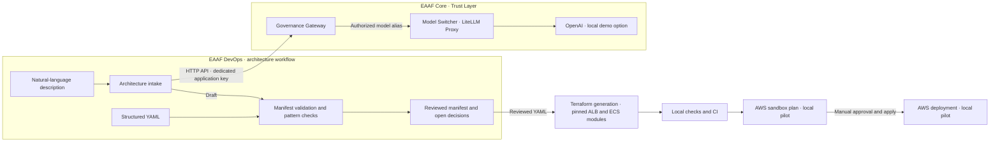
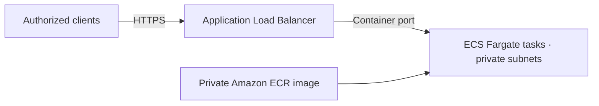

# EAAF DevOps

EAAF DevOps is the AWS-first Architecture-to-Terraform module of the Enterprise Agentic AI Framework. It lives in a separate repository and uses EAAF Core as its governance layer for model calls.

The current MVP starts with a YAML description of one stateless HTTP container. The local workflow validates the YAML and generates a Terraform module call and its inputs.

The deployment repository supplies the description, reviewed YAML, and prepared Terraform module. Generate into that repository by passing its module directory or a pinned GitHub module source. The [deployment demo](https://github.com/tandrian06/eaaf-deployment-demo) shows this workflow end to end. The [AWS sandbox guide](docs/aws-sandbox.md) documents the separate pilot with private networking and an internal load balancer.

```powershell
$demo = "..\eaaf-deployment-demo"
.\.venv\Scripts\python.exe -m eaaf_devops --demo "$demo/examples/container-demo.yaml" --output "$demo/deployments/demo" --module-source "$demo/modules/aws-fargate-demo"
```

EAAF reads the module's Terraform declarations to discover input names, types, defaults, and outputs. Supply `region` for the AWS provider. An input with a module default can be omitted, and the generated call lets Terraform use that default. Terraform evaluates module-specific validation rules.

To draft the YAML from a description, run `--describe-demo` with the same `--module-source` and the EAAF Gateway configured. Review the extracted values before generation. For a pinned GitHub module source, provide `--module-dir` pointing to a local checkout of that module revision.

## Repositories

| Repository | What it contains |
| --- | --- |
| [EAAF Core](https://github.com/tandrian06/eaaf) | Governance Gateway, LiteLLM routing, Chat, and department RAG. It governs model calls used to draft architecture from text. |
| [EAAF DevOps](https://github.com/tandrian06/eaaf-devops) | Architecture intake, validation, and the reusable CLI that generates Terraform module calls and input files. |
| [EAAF Deployment Demo](https://github.com/tandrian06/eaaf-deployment-demo) | A working example that takes reviewed YAML and a prepared Terraform module through generation, PR review, and an optional AWS Fargate deployment. |

## Advanced architecture



Solid lines show the paths implemented today. Dashed lines show planned steps. EAAF Core authenticates DevOps and applies its model allowlist, quotas, simulated budget, and audit policy. DevOps owns the architecture schema, AWS pattern rules, and review status. The structured YAML path runs locally with Python and needs neither the Gateway nor an AWS account. The description path requires the local Gateway and sends the input to OpenAI through LiteLLM.

## Components and delivery roadmap

| Increment | Component | Demonstrable outcome | Status |
| --- | --- | --- | --- |
| 1 | Architecture contract | Validate YAML against the ECS Fargate pattern and report missing inputs or conflicts. | Available |
| 2 | Governed architecture intake | Draft a manifest from a description through the dedicated DevOps identity and apply the same validation as for YAML. | Available |
| 3 | Terraform generation | Compose pinned ALB and ECS modules from a reviewed YAML manifest. Check formatting and validate the generated configuration. | Available |
| 4 | AWS sandbox pilot | Review the plan, verify running tasks and ALB target health, and clean up the resources. | Completed and cleaned up |

Each increment has its own validation step. The first three can be exercised with fictional examples. Terraform generation produces deterministic output. The sandbox pilot uses real AWS access for planning, with human approval before apply. Its two tasks and ALB target health have been verified. Client HTTPS access and teardown remain to be validated.

## AWS ECS Fargate web service



The application is stateless and runs without public task IP addresses. The load balancer can be public or internal. The pattern uses an existing VPC and private subnets. The manifest records how tasks reach dependencies, either through NAT or the VPC endpoints required by the workload. [AWS ECS load balancing](https://docs.aws.amazon.com/AmazonECS/latest/developerguide/service-load-balancing.html) · [AWS Fargate task networking](https://docs.aws.amazon.com/AmazonECS/latest/developerguide/fargate-task-networking.html)

| Section | Inputs needed for review |
| --- | --- |
| `application` | Container port, private ECR image URI, confirmation that the application is stateless |
| `aws` | Workload region and existing VPC ID |
| `ingress` | Public or internal HTTPS entry point, domain name, ACM certificate ARN |
| `runtime` | Two or more distinct private subnet IDs and an outbound connectivity choice |

The [version 1 schema](eaaf_devops/architecture.py) rejects unexpected fields and invalid field types. The validator derives the status and lists open decisions and conflicts. The example account and resource IDs are fictional.

`ready_for_review` means the manifest contains the inputs required for this pattern. An AWS review still checks resource ownership and existence, certificate coverage, subnet placement and routes, IAM, and security groups before a Terraform plan can be approved.

## Run locally

Use Python 3.12 and run from the repository root.

```sh
python -m pip install -r requirements-dev.txt
python -m eaaf_devops examples/complete.yaml
python -m eaaf_devops --schema
python -m pytest -q
```

| Example | Expected result | Exit code |
| --- | --- | ---: |
| [Complete](examples/complete.yaml) | `ready_for_review` | 0 |
| [Incomplete](examples/incomplete.yaml) | `needs_input` with open decisions | 2 |
| [Outside the pattern](examples/outside-pattern.yaml) | `unsupported` with an explanation | 3 |

Unreadable or invalid input exits with code 1.

## Generate Terraform from reviewed YAML

Run from the repository root with Terraform installed. Use a fresh output file for each generation.

```powershell
New-Item -ItemType Directory -Force build | Out-Null
python -m eaaf_devops examples/complete.yaml --terraform build/main.tf
terraform -chdir=build fmt -check
terraform -chdir=build init -backend=false -input=false
terraform -chdir=build validate
```

The CLI revalidates the manifest before rendering a versioned template. It creates the output only for `ready_for_review` and refuses to overwrite a file. The template uses the community ALB module at `9.17.0`, the ECS cluster and service submodules at `6.0.0`, and the AWS provider at `6.0.0`. Initialization downloads these dependencies. Formatting and validation can run without AWS credentials.

For a sandbox plan, supply the workload name, existing ALB subnets in distinct Availability Zones, and the allowed client IPv4 CIDRs. A public ALB requires public ALB subnets. Fargate tasks use the manifest's private subnets and have no public IP. The template expects the existing network to provide the selected NAT or VPC endpoint connectivity and uses the supplied ACM certificate and ECR image. Arrange DNS for the output application domain in the existing DNS zone. The demo defaults to two tasks with 256 CPU units and 512 MiB of memory. The image must support a read-only root filesystem and return HTTP 200 on `/` for the ALB health check.

## Draft from a description

Use an EAAF Core checkout with the optional OpenAI Compose configuration and a local `OPENAI_API_KEY`. From EAAF DevOps, prepare the dedicated key and a local policy overlay. This PowerShell example assumes sibling checkouts.

```powershell
python scripts/configure_local_gateway.py ../EAAF
docker compose --env-file ../EAAF/.env --env-file .env -f ../EAAF/compose.yaml -f ../EAAF/compose.openai.yaml -f compose.eaaf-devops.yaml up --build --wait
python -m eaaf_devops --describe examples/request.txt
```

The command sends the description through EAAF to OpenAI. Use synthetic descriptions for this demo. The call can incur API charges. The DevOps key and generated policy overlay stay in Git-ignored files. Core continues to serve its existing applications. The DevOps identity is authorized only for the dedicated architecture model alias.

The result is a draft for review. It retains deployment identifiers only when they appear in the description, and the validator reports missing fields and pattern conflicts. The model can still misinterpret a request. Review the draft before using it as infrastructure input.
