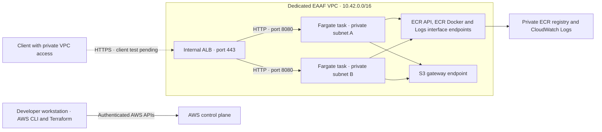

# AWS sandbox guide

This guide describes the first EAAF DevOps deployment exercised in Europe (Stockholm), `eu-north-1`, on 10 November 2026. It covers account setup, IAM permissions, the deployment stages, inspection, recovery, costs, and cleanup.

The application is a static demo page served by a container. It demonstrates that reviewed architecture inputs can produce a working ECS Fargate deployment through pinned Terraform modules. EAAF Core remains on the developer's machine for governed model calls. The AWS demo does not deploy Core.

## Delivery status

| Capability | Evidence |
| --- | --- |
| Manifest validation and Terraform generation | 18 Python tests passed. |
| Real AWS plan | Reviewed the proposed application resources before apply. |
| Dedicated VPC and private connectivity | Network and endpoint applies completed. |
| ECS deployment | Two running tasks and a completed service rollout. |
| ALB health checks | Two healthy targets on port 8080. |
| Browser HTTPS test | Pending a client with private VPC access, name resolution, and certificate trust. |
| Teardown | Procedure documented below. Execution and delete permissions remain to be tested. |

GitHub Actions checks Python tests, Terraform formatting, initialization, and validation with fictional inputs. The cloud plan and apply were performed locally with an authenticated AWS identity.

## Architecture and ownership



Each interface endpoint spans the two private subnets and uses private DNS. The S3 gateway endpoint attaches to the two private route tables. Tasks use these paths to pull ECR layers and send logs. The VPC has DNS support and DNS hostnames enabled. [AWS ECR endpoint requirements](https://docs.aws.amazon.com/AmazonECR/latest/userguide/vpc-endpoints.html)

The local sandbox uses the following ownership boundaries.

| Location | Contents | Terraform state |
| --- | --- | --- |
| `build/sandbox-network/` | Dedicated VPC, subnets, route tables, default security group configuration, private endpoints and their access rules | Local `terraform.tfstate` |
| `build/sandbox-application-plan/` | Generated ALB and ECS configuration, execution role, IAM policy, logs, and autoscaling | Separate local `terraform.tfstate` |
| `build/sandbox-inputs/` | Real architecture YAML and application `sandbox.tfvars` | Inputs only |
| `build/sandbox-app/` | Demo image source and locally instantiated permission policies | ECR repository, image, and ACM certificate were provisioned separately |

The original default VPC also exists in the account. The EAAF deployment targets the dedicated VPC. For the initial installation, 14 managed resource instances were recorded in the network state and 22 in the application state. AWS inventory can also show objects created by services, account defaults, and the separately provisioned ECR and ACM resources. Reconcile by IDs and ownership before deleting anything.

## Account and prerequisites

Create a dedicated sandbox account using the AWS signup flow, and choose the account plan AWS offers for your eligibility. Existing or former customers may be ineligible for the new-customer free plan and credits. Confirm the chosen plan and remaining credits in Billing. [AWS Free Tier eligibility](https://aws.amazon.com/free/free-tier-faqs/)

Use the root identity for initial account administration, enable MFA, and keep its password and recovery details in a password manager. An administrator creates the sandbox IAM users and attaches the policies below. [AWS root account setup](https://docs.aws.amazon.com/IAM/latest/UserGuide/getting-started-account-iam.html)

The local demonstration used Windows PowerShell, Python 3.14, AWS CLI v2.39.7, Docker Desktop with Linux containers, and Terraform 1.14.0. The pinned dependency versions are AWS provider 6.0.0, VPC and VPC endpoints module 6.0.0, ALB module 9.17.0, and ECS cluster/service modules 6.0.0.

Install the CLI from the AWS website and Terraform from HashiCorp. Verify the downloaded installers or archives using the publisher signature or published checksums. `aws login` requires AWS CLI 2.32.0 or later. [AWS CLI installation](https://docs.aws.amazon.com/cli/latest/userguide/getting-started-install.html) · [Terraform installation](https://developer.hashicorp.com/terraform/install)

## Identities and permission stages

| Identity | Purpose | Attachments |
| --- | --- | --- |
| Account administrator | Create IAM users and manage their policies | Existing administrator or root session during account setup |
| `eaaf-sandbox-reader` | Inspect VPCs, routes, subnets, endpoints, and load balancers | AWS `AmazonEC2ReadOnlyAccess` and `SignInLocalDevelopmentAccess` |
| `eaaf-sandbox-builder` | Create the approved sandbox infrastructure | The same two AWS policies plus the four staged custom policies below |
| Terraform-created task execution role | Let ECS pull the image and write container logs | Generated role and execution policy |
| Service-linked roles | Let ECS, ELB, and Application Auto Scaling manage their integration | Created by AWS when required |

The reader's network policy covers EC2/VPC and load balancer inspection. Reading ECR, ACM, ECS, logs, and IAM requires the relevant additional permissions. The builder's custom policies supply the creation and inspection actions used in this deployment.

For a console user, choose a generated temporary password and require a change at first login. Preserve the IAM sign-in link and temporary password in a password manager. Check that the user can change their password. An administrator can allow this through the account password policy or `IAMUserChangePassword`. [IAM password policy](https://docs.aws.amazon.com/IAM/latest/UserGuide/id_credentials_passwords_account-policy.html)

### Custom policy templates

The templates below preserve the policies used in the successful sandbox deployment, including the extra EC2 quota-validation permission encountered during ALB creation.

| Policy name | Template | Attach when |
| --- | --- | --- |
| `EAAFSandboxNetworkCreate` | [network-create.json](iam/network-create.json) | Before creating the VPC and its private subnets |
| `EAAFSandboxEndpointCreate` | [endpoint-create.json](iam/endpoint-create.json) | After recording the VPC, subnet, and route-table IDs |
| `EAAFSandboxAppInputs` | [app-inputs.json](iam/app-inputs.json) | Before creating the ECR repository, pushing the image, and importing the certificate |
| `EAAFSandboxAppDeploy` | [app-deploy.json](iam/app-deploy.json) | Before the ALB and ECS apply |

Instantiate these templates locally before creating policies in IAM. Replace `<AWS_ACCOUNT_ID>` with the 12-digit account ID. After the network apply, also replace `<VPC_ID>`, `<PRIVATE_SUBNET_A>`, `<PRIVATE_SUBNET_B>`, `<PRIVATE_ROUTE_TABLE_A>`, and `<PRIVATE_ROUTE_TABLE_B>` with the corresponding Terraform outputs. All templates target `eu-north-1` and the documented sandbox names.

Copy the JSON into **IAM → Policies → Create policy → JSON**, review it, name the policy as shown above, and attach it to the builder. Use the JSON editor to update an existing policy when required. Review the effective policy version and the user's attachments.

These policies are sandbox creation policies. Some statements use regional wildcards for generated security groups, target groups, or operations without a pre-existing resource ID. The builder can create a prefixed execution role and policy and pass that role to ECS tasks. Treat this as an infrastructure deployment identity. Production use needs a separate permissions-boundary and role design. Delete and general update permissions are outside the creation policies.

### Authenticate from PowerShell

Run from a new PowerShell window with the AWS CLI on `PATH`.

```powershell
aws login --profile eaaf-sandbox --region eu-north-1
aws sts get-caller-identity --profile eaaf-sandbox --region eu-north-1

aws login --profile eaaf-sandbox-builder --region eu-north-1
aws sts get-caller-identity --profile eaaf-sandbox-builder --region eu-north-1
```

Select the reader for `eaaf-sandbox` and the builder for `eaaf-sandbox-builder` in the browser. The profile name is a local label. Confirm the returned account and IAM user ARN before using it. If the browser selected the wrong user, run `aws logout --profile eaaf-sandbox-builder`, then log in again with the correct console session. AWS refreshes temporary credentials within the login session. [AWS CLI browser login](https://docs.aws.amazon.com/cli/latest/userguide/cli-configure-sign-in.html)

The optional prompt to configure AWS skills and an MCP server can be skipped with `n` for this CLI workflow.

The deployment used the temporary credentials obtained through the CLI to authenticate the pinned Terraform provider. A reusable alternative documented by AWS is a separate `credential_process` profile. Configure it once, then select it for Terraform. This keeps the credential JSON out of terminal output. This profile configuration is documented here and has not yet been exercised in the EAAF sandbox.

```powershell
aws configure set credential_process 'aws configure export-credentials --profile eaaf-sandbox-builder --format process' --profile eaaf-terraform
aws configure set region eu-north-1 --profile eaaf-terraform
$env:AWS_PROFILE = "eaaf-terraform"
aws sts get-caller-identity
```

The source profile and the Terraform profile must have different names to avoid a recursive credential process. Clear stale `AWS_ACCESS_KEY_ID`, `AWS_SECRET_ACCESS_KEY`, and `AWS_SESSION_TOKEN` variables in the shell if they override the selected profile. Store the AWS configuration and session cache under the user profile. [AWS credential process configuration](https://docs.aws.amazon.com/cli/latest/userguide/cli-configure-sign-in.html)

## Stage 1 — review and create the network

The [network example](examples/aws-sandbox/network.tf) describes a dedicated `10.42.0.0/16` VPC with private subnets `10.42.10.0/24` and `10.42.20.0/24` in `eu-north-1a` and `eu-north-1b`. Choose an address range suitable for your own network connections. Replace the account placeholder in the provider's `allowed_account_ids`.

For a fresh sandbox, copy only `network.tf` into `build/sandbox-network/`, then initialize and review it.

```powershell
terraform -chdir=build/sandbox-network init -input=false
terraform -chdir=build/sandbox-network validate
terraform -chdir=build/sandbox-network plan -input=false -out=network.tfplan
```

Review the account, region, CIDR, zones, and resource actions. After approval, apply the saved plan and record the outputs.

```powershell
terraform -chdir=build/sandbox-network apply network.tfplan
terraform -chdir=build/sandbox-network output
terraform -chdir=build/sandbox-network state list
```

The first network plan contained eight additions. To obtain the route-table IDs for the next policy, inspect `module.network.aws_route_table.private[0]` and `[1]` using `terraform state show` or the VPC console.

For an existing sandbox, use its original configuration and state directory. An empty directory and new state would propose an additional network.

## Stage 2 — private connectivity

After updating and attaching the endpoint policy, copy [connectivity.tf](examples/aws-sandbox/connectivity.tf) into the same network directory. Run `terraform init` again for the additional module and create a separate reviewed plan.

```powershell
terraform -chdir=build/sandbox-network init -input=false
terraform -chdir=build/sandbox-network plan -input=false -out=connectivity.tfplan
# After approval
terraform -chdir=build/sandbox-network apply connectivity.tfplan
```

The first connectivity plan contained six additions. The three interface endpoints are `ecr.api`, `ecr.dkr`, and `logs`. Each is deployed in both subnets. Their shared security group accepts HTTPS from the private subnet CIDRs. The S3 gateway endpoint's policy allows the ECR layer bucket in Stockholm.

The interface endpoints incur hourly charges per Availability Zone and data processing charges while provisioned. S3 gateway endpoints have no additional endpoint charge. [PrivateLink pricing](https://aws.amazon.com/privatelink/pricing/) · [S3 gateway endpoints](https://docs.aws.amazon.com/vpc/latest/privatelink/vpc-endpoints-s3.html)

## Stage 3 — image and test certificate

The [demo Dockerfile](examples/aws-sandbox/Dockerfile) serves [index.html](examples/aws-sandbox/index.html) using Python's HTTP server on port 8080. It runs as a non-root user and supports a read-only root filesystem. Build it for Linux AMD64 and check HTTP 200 on `/` before publishing.

```powershell
docker build --platform linux/amd64 -t eaaf-sandbox-demo:1.0.0 docs/examples/aws-sandbox
aws ecr create-repository --repository-name eaaf-sandbox-demo --image-tag-mutability IMMUTABLE --profile eaaf-sandbox-builder --region eu-north-1
```

For an existing repository, inspect it with `describe-repositories` and reuse it. Set `$sandboxAccountId` to the verified account ID, authenticate, and publish the image.

```powershell
$registry = "$sandboxAccountId.dkr.ecr.eu-north-1.amazonaws.com"
$image = "$registry/eaaf-sandbox-demo:1.0.0"
aws ecr get-login-password --profile eaaf-sandbox-builder --region eu-north-1 | docker login --username AWS --password-stdin $registry
docker tag eaaf-sandbox-demo:1.0.0 $image
docker push $image
docker logout $registry
aws ecr describe-images --repository-name eaaf-sandbox-demo --image-ids imageTag=1.0.0 --profile eaaf-sandbox-builder --region eu-north-1
```

Use the returned digest in the manifest as `ACCOUNT.dkr.ecr.eu-north-1.amazonaws.com/eaaf-sandbox-demo@sha256:DIGEST`. Immutable tags prevent silently replacing an existing tag. [ECR push permissions](https://docs.aws.amazon.com/AmazonECR/latest/userguide/image-push-iam.html)

The first deployment used the internal test name `api.eaaf.test` and a self-signed RSA-2048 certificate valid for 90 days, imported into ACM in Stockholm. An imported certificate requires a certificate PEM and its matching unencrypted private key PEM. For this sandbox, create them in an access-controlled temporary directory, include the DNS name in the subject alternative name, and import with the required tags.

```powershell
aws acm import-certificate --certificate fileb://certificate.pem --private-key fileb://private.pem --tags Key=Project,Value=EAAF Key=Environment,Value=sandbox --profile eaaf-sandbox-builder --region eu-north-1
```

Record the certificate ARN in the manifest. The successful deployment generated the key locally, removed its temporary PEM after import, and kept it out of Git and Terraform state. ACM retains the imported private key for use by the listener. Plan certificate replacement before expiry. [ACM import requirements](https://docs.aws.amazon.com/acm/latest/userguide/import-certificate-prerequisites.html)

The name does not create a DNS record. A client must resolve it to the ALB, have a network route into the VPC, and trust the test certificate for a verified HTTPS test. The initial rollout checked ALB target health. Client HTTPS access remains a separate validation step.

## Stage 4 — application plan and deployment

Create `build/sandbox-inputs/sandbox.yaml` from [examples/complete.yaml](../examples/complete.yaml). Keep the same schema, replace every fictional resource identifier with the actual sandbox value, and set `ingress.visibility` to `internal` and `runtime.outbound_access` to `vpc-endpoints`.

Create `build/sandbox-inputs/sandbox.tfvars` with the two real subnet IDs. For this internal demo the ALB shares the task subnets and accepts client traffic from the VPC CIDR.

```hcl
name              = "eaaf-devops-sandbox"
alb_subnet_ids    = ["<PRIVATE_SUBNET_A>", "<PRIVATE_SUBNET_B>"]
client_ipv4_cidrs = ["10.42.0.0/16"]
```

After attaching the application deployment policy, generate into a fresh application directory and review the plan.

```powershell
New-Item -ItemType Directory -Force build/sandbox-application-plan | Out-Null
python -m eaaf_devops build/sandbox-inputs/sandbox.yaml --terraform build/sandbox-application-plan/main.tf
terraform -chdir=build/sandbox-application-plan fmt -check
terraform -chdir=build/sandbox-application-plan init -input=false
terraform -chdir=build/sandbox-application-plan validate
terraform -chdir=build/sandbox-application-plan plan -input=false -var-file=../sandbox-inputs/sandbox.tfvars -out=application.tfplan
# After approval
terraform -chdir=build/sandbox-application-plan apply application.tfplan
```

The generator refuses to overwrite a file. Preserve the deployed file and state during a regeneration. Render a new candidate outside the active root, compare it, and replace the generated configuration only after review.

The first application plan had 22 additions. It used an internal ALB, port 443 with the imported certificate, port 8080 to the targets, two desired tasks with 256 CPU units and 512 MiB memory each, a read-only root filesystem, and the module's CloudWatch logging.

The ECS module also enables CPU and memory target tracking autoscaling. Its configured range is one to ten tasks. Two is the initial desired count, so the running count can change with load. The ALB has deletion protection enabled. These settings affect cost and cleanup.

### Plan-time issue found during the first deployment

ECS module 6.0.0 iterates a null default capacity-provider strategy if omitted. Terraform validation passed, while the real plan failed. The local template was corrected to specify the Fargate strategy.

```hcl
default_capacity_provider_strategy = {
  FARGATE = { weight = 1 }
}
```

Use the corrected template when reproducing this deployment. A successful `terraform validate` covers configuration validity. A real plan also exercises data reads and values resolved during planning. [Terraform plan behavior](https://developer.hashicorp.com/terraform/cli/commands/plan)

## Inspect and recover

Use the verified builder profile for the commands below. Set `$sandboxCluster` and `$sandboxService` to `eaaf-devops-sandbox`.

```powershell
aws ecs describe-services --cluster $sandboxCluster --services $sandboxService --profile eaaf-sandbox-builder --region eu-north-1
terraform -chdir=build/sandbox-application-plan output
terraform -chdir=build/sandbox-network state list
terraform -chdir=build/sandbox-application-plan state list
```

Obtain the target-group ARN from **EC2 → Target Groups** or Terraform state, then run `aws elbv2 describe-target-health --target-group-arn ARN --profile eaaf-sandbox-builder --region eu-north-1`. Completion means the ECS rollout is `COMPLETED`, the desired tasks are running, and both ALB targets are `healthy`.

| Console location in Stockholm | What to inspect |
| --- | --- |
| VPC → Your VPCs → `eaaf-sandbox` | Subnets, routing, DNS, and endpoints |
| ECS → Clusters → `eaaf-devops-sandbox` | Service, deployments, running tasks, stopped reasons |
| EC2 → Load Balancers and Target Groups | ALB scheme, listener, target health |
| ECR → `eaaf-sandbox-demo` | Image tag and digest |
| Certificate Manager | Imported certificate domain and expiry |
| CloudWatch → Log groups | `/aws/ecs/eaaf-devops-sandbox` and its `/app` group |

Log-event inspection needs separate `logs:GetLogEvents` or `logs:FilterLogEvents` permission. The deployment policy allows creating and inspecting log-group configuration.

After a failed apply, keep the current state and review the reported failure. The initial apply stopped at ALB creation because the deployment policy lacked `ec2:ValidateSecurityGroupQuotasForInterface`. Eight resources were already recorded. Adding that action and replanning produced 14 remaining additions and completed the deployment. The included policy incorporates the correction.

Resume from the same directory using a new plan. Check for unexpected replacements, deletions, or changes beyond the approved scope before applying it. The previous saved plan becomes stale after a partial apply. For task startup failures, inspect ECS events and stopped-task reasons, then check image digest, execution-role access, endpoint DNS, and security-group rules.

## State, private inputs, and source control

`build/` is Git-ignored and holds account-specific files, plans, and both local states. Each state binds the configuration to real AWS resources. Preserve each complete root directory and its state backup in access-controlled storage. Keeping the configuration alone is insufficient for normal management of the existing resources. Terraform plans and state can contain sensitive values. [Terraform sensitive data](https://developer.hashicorp.com/terraform/language/manage-sensitive-data)

Record which checkout owns the deployment. During the first demonstration, the active state directories were inside a separate Git worktree used for review. Removing a worktree or deleting `build/` can remove the only local state copy. Make a protected backup before moving directories, changing branches across infrastructure versions, or cleaning generated files.

The repository contains portable examples and policy placeholders. Local manifests, actual account IDs and resource identifiers, private keys, login caches, plan files, and state remain in local configuration. Commit reviewed provider lock files alongside infrastructure source when adopting a persistent deployment layout. A shared encrypted remote backend with state locking and recovery is a follow-up before team operation.

GitHub Actions currently performs offline configuration checks after downloading dependencies. A future AWS deployment workflow should use GitHub OIDC to assume a scoped AWS role, plus approval on the target environment. It requires its own access design.

## Cost and cleanup

The running sandbox consumes resources over time. Review Fargate task hours, ALB hours and capacity units, three interface endpoints in two zones, ECR storage, and CloudWatch ingestion and storage. Autoscaling can increase the task count. Account credits and the chosen AWS plan determine how eligible usage is paid. Check Billing and configure a budget alert. A budget alert reports spend and does not by itself stop workloads. [Fargate pricing](https://aws.amazon.com/fargate/pricing/) · [ALB pricing](https://aws.amazon.com/elasticloadbalancing/pricing/) · [PrivateLink pricing](https://aws.amazon.com/privatelink/pricing/) · [AWS budget alerts](https://docs.aws.amazon.com/cost-management/latest/userguide/budgets-managing-costs.html)

Cleanup has not been exercised. Arrange a separately reviewed cleanup role or administrator session before running destructive commands. The four builder policies intentionally focus on creation and lack the delete actions needed for teardown.

1. Back up both state directories, confirm the target account, and review the complete ownership inventory.
2. Disable ALB deletion protection through a reviewed configuration change in the application root, plan, and apply that change. The module input is `enable_deletion_protection = false`.
3. Plan application destruction using the original application state and the same variable file. Review and approve the saved destroy plan before applying it.
4. Once application dependencies are removed, plan and approve destruction of the network root, including the interface endpoints.
5. Separately review deletion of the private ECR repository and its image, the imported ACM certificate, and sandbox IAM users and custom policies. These objects are outside the two Terraform states. Service-linked roles may be shared by other resources in the account.
6. Verify remaining resources and billing usage after cleanup. Retain the final state and operation records.

The commands below prepare destructive plans. Applying them is a separate approval step.

```powershell
terraform -chdir=build/sandbox-application-plan plan -destroy -input=false -var-file=../sandbox-inputs/sandbox.tfvars -out=destroy-application.tfplan
# Review, approve, then apply the saved application destroy plan.
# After the application is removed
terraform -chdir=build/sandbox-network plan -destroy -input=false -out=destroy-network.tfplan
# Review, approve, then apply the saved network destroy plan.
```

Cleanup permissions need ECS service update/delete and task-definition deregistration, Application Auto Scaling policy deletion and target deregistration, ELB listener/load balancer/target-group deletion, CloudWatch group deletion, IAM detach/delete for the generated role and policy, and EC2 endpoint/security-group/route-table/subnet/VPC deletion. Scope these to the recorded sandbox resources and include their required reads. Validate the cleanup role through the reviewed destroy plans.
